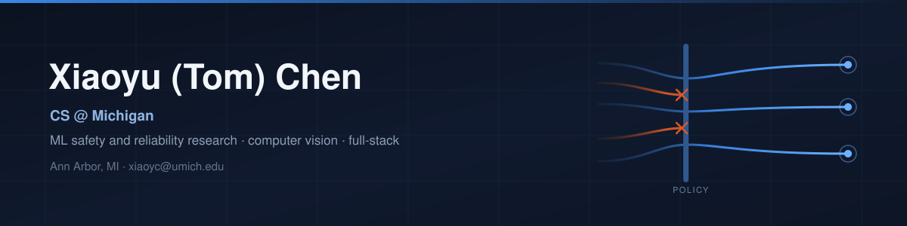
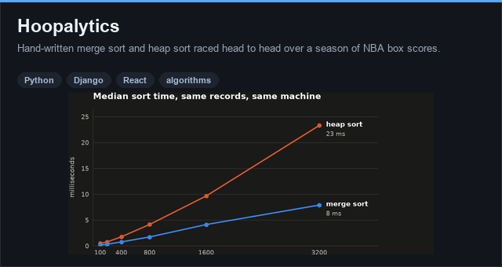
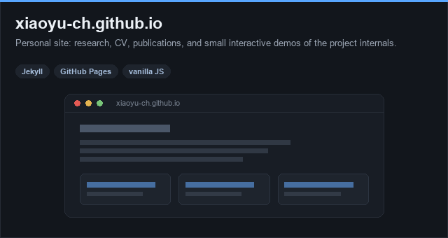
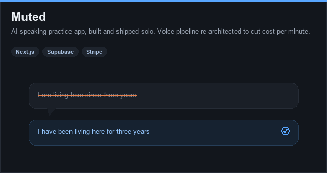
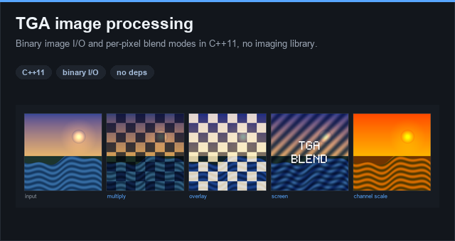
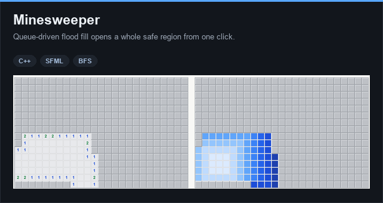

I'm a CS junior at the University of Michigan, transferred from the University of Florida, and I work on making machine learning systems behave predictably when they are put under pressure.
Most of my time goes to research on LLM agent safety and reliability; the rest goes to building and shipping things end to end.

**Open to Summer 2027 software engineering and ML internships.** BS Computer Science, May 2028.

---

## Now

- **LLM agent safety benchmarking** at the TEA Lab, University of Florida ECE, an industry-sponsored collaboration. I own the data pipeline: large-scale evaluation runs on multi-GPU HPC under SLURM, and uncertainty signals (token log-probabilities and entropy) extracted from open-weight models in a single pass.
- **Reliability of coding agents** at OrderLab, University of Michigan EECS. I build the evaluation harness for sandbox policies, testing what a policy actually permits and blocks across matched scenario pairs.
- **Medical dialogue generation**, independent research: discrete latent encoding for more controllable and interpretable generation. Presented at AICCONF 2026.

---

## Featured work

<table>
<tr>
<td width="50%" valign="top">

### [Hoopalytics](https://github.com/Xiaoyu-Ch/hoopalytics)

Merge sort and heap sort, both written from scratch, race each other over a season of NBA box scores, and the app reports who won. A Django backend aggregates per-player averages with pandas and times both sorts on every request; a React front end lets you pick the stat to rank by.

`Python` `Django` `React` `pandas`

</td>
<td width="50%" valign="top">

### [xiaoyu-ch.github.io](https://xiaoyu-ch.github.io)

My site: research, CV, publications, and project write-ups. Each project page carries a small interactive demo of the idea inside it, including a live merge-sort versus heap-sort race and an Elo-scoring widget, all written by hand in vanilla JS.

`Jekyll` `GitHub Pages` `vanilla JS`

</td>
</tr>
<tr>
<td width="50%" valign="top">

### [Muted](https://xiaoyu-ch.github.io/projects/muted/)

An AI-first English speaking-practice app, designed, built, and shipped solo, currently in a small beta. The first voice pipeline was too expensive per minute to work for students, so I re-architected it around browser-native speech recognition plus a text model and cut the cost per minute by over 95%. I also found and closed a permission gap that let a client bypass the paid checkout flow.

`Next.js` `Supabase` `Stripe` `Web Speech API`

</td>
<td width="50%" valign="top">

### [TGA image processing](https://github.com/Xiaoyu-Ch/CLI-image-processing)

A small imaging library in C++11 with no dependencies: it parses the TGA binary format by hand, then implements Photoshop-style blend modes, channel arithmetic, and channel split and combine as per-pixel math. The images on that card are its actual output.

`C++11` `binary file I/O` `no dependencies`

</td>
</tr>
<tr>
<td colspan="2" valign="top">

### [Minesweeper](https://github.com/Xiaoyu-Ch/Minesweepers)

Minesweeper in C++ and SFML, with the classic extras: timer, leaderboard, debug mode, and a configurable board.

The interesting part is the reveal. One click on an empty tile runs a queue-driven flood fill that opens the whole safe region, counting each tile's neighbouring mines as it goes rather than precomputing the board. The right-hand board above shows the order the queue reaches each tile.

`C++` `SFML` `BFS`

</td>
</tr>
</table>

---

## Research

**Research Assistant**, TEA Lab, University of Florida ECE (industry-sponsored collaboration), May 2026 to present
Own the data pipeline for an LLM agent-safety benchmark: single-pass log-probability and entropy extraction from an open-weight model, executed at scale on dual-GPU HPC under SLURM. Tracked down silent GPU memory corruption, a floating-point overflow, and a label-leakage flaw in the data, and built the diagnostics that tell genuine detection apart from a model exploiting how the data was split.

**Undergraduate Researcher**, OrderLab, University of Michigan EECS, July 2026 to present
Evaluation of sandbox policies for coding agents. Built the harness that runs matched pairs of legitimate and cheating scenarios against policies at several strictness levels, so a policy can be judged on what it actually permits and blocks rather than on how it is described.

**Undergraduate Research Assistant**, Computer Vision and Sensing Lab, University of Florida ABE, February to August 2026
Perception pipeline for an autonomous harvesting robot: depth estimation, object detection, and segmentation over field footage, trained and run on university HPC.

**Independent Researcher**, Zhongbo Zhichuang Technologies, September 2025 to present
Discrete latent encoding (VQ-VAE) applied to doctor-patient dialogue for more controllable and interpretable medical dialogue generation.

---

## Publications

- **A Doctor Dialogue Model Based on Vector Quantisation.** AICCONF 2026 (IEEE SMC). Oral presentation.
- **CRetor: A Mandarin Counter-Speech Dataset.** Submitted to ACL Rolling Review, 2025.
- **From Theory to Reality: The Quest for Gravitational Waves.** CONF-CIAP 2024.

Two further papers are in progress, aimed at ACL and OSDI.

---

## Tech

     

    

   

     

---

## Elsewhere

[**Website**](https://xiaoyu-ch.github.io) · [**LinkedIn**](https://www.linkedin.com/in/xiaoyu-tom-chen-658251335) · **Email** xiaoyc@umich.edu
